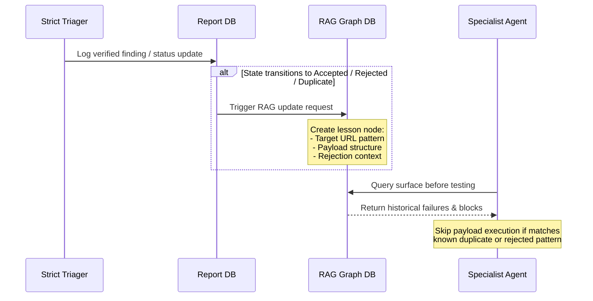

# 🌩️ STORM-HUNT: Bug-Bounty-Only Reassessment & Operational Architecture

This document provides a complete reassessment and redesign of the **STORM-HUNT** framework, pivoting it to a **bug-bounty-only** operational model. It completely removes all CTF elements and builds a structured, high-observability architecture aligned with the **Swiss Post E-Voting** YesWeHack program.

---

## 1. Executive Reassessment

The previous hybrid CTF-Bug Bounty design suffered from a fundamental misalignment of operational realities:

1. **Safety vs. Speed:** CTF environments reward high-speed, noisy, unconstrained exploitation loops. Bug Bounty programs (especially critical infrastructure like Swiss Post E-Voting) strictly penalize automated noise. Mass scanning violates YesWeHack rules of engagement, risks WAF blocks, and threatens legal safe harbor.
2. **Evidence Standards:** A CTF agent's success is a binary string (the flag). A Bug Bounty submission requires context, mapping to specific protocol steps (e.g., VEleS trust model), showing that it is not mitigated elsewhere, and proving impact on the live target (`pit.evoting.ch`). Static claims are rejected under section C.5.1 of the Swiss Post program guidelines.
3. **Economics:** CTF token burn is short-term and transactional. Bug Bounty token spend must be treated as capital investment with strict budgets, local offloading, and filtering models to ensure profitability.

Pivoting STORM-HUNT to a **Bug-Bounty-Only** framing refocuses the codebase on low req/s rate-limiting, deep source-code auditing, logical analysis, strict triage verification, and precise reporting.

---

## 2. What to Remove

The following components must be purged from the planning, directory structures, and tools:

* **Docker Challenge Sandbox (`ctf/executor/`):** The isolated, ephemeral local container runner.
* **Binary RE Specialists:** GDB connectors, Ghidra decompilation parsers, buffer/heap overflow payload generators.
* **Flag-Matching Loops:** Regex filters scanning command stdout/stderr for target flags (`CTF{...}`, `FLAG{...}`).
* **Scoring/Leaderboard Integrations:** ROI and progression models that track points, flags submitted, or ranking structures.
* **High-Rate Fuzzers:** Standard mass `ffuf` or `gobuster` adapters that default to high requests-per-second without rate-limiting overrides.

---

## 3. Revised Bug-Bounty Architecture

STORM-HUNT is reconstructed around a modular, low-volume, high-precision swarm.

```mermaid
graph TD
    User([Analyst]) -->|Target, Scope, RoE| Coordinator[TS Coordinator]
    
    Coordinator -->|Checks Scope & Limits| ScopeGate[Egress Scope Gate]
    ScopeGate -->|1-2 req/s + Custom UA| LiveTarget[https://pit.evoting.ch]
    
    Coordinator -->|Phase Task Dispatch| PhaseOrchestrator[Kill Chain Orchestrator]
    
    subgraph Specialists (Bounty-Optimized)
        AuthSpec[Auth & Cryptographic Specialist]
        UploadSpec[Upload/Deserialization Specialist]
        TallySpec[Tallying & State Specialist]
        JSWorkerSpec[Client-Side JS Analyst]
    end
    
    PhaseOrchestrator --> AuthSpec
    PhaseOrchestrator --> UploadSpec
    PhaseOrchestrator --> TallySpec
    PhaseOrchestrator --> JSWorkerSpec
    
    Specialists -->|Lookup techniques & history| RAG[Vector RAG MCP Server]
    Specialists -->|Candidate findings| StrictTriager[Strict Triager & Negative Control]
    
    StrictTriager -->|Verified Findings| EvidenceVault[Evidence Vault]
    EvidenceVault -->|Structured Report Gen| ReportGen[Bounty Report Formatter]
    
    classDef core fill:#4f46e5,stroke:#312e81,color:#fff;
    classDef spec fill:#0891b2,stroke:#155e75,color:#fff;
    classDef util fill:#15803d,stroke:#14532d,color:#fff;
    class Coordinator,PhaseOrchestrator core;
    class AuthSpec,UploadSpec,TallySpec,JSWorkerSpec,StrictTriager spec;
    class ScopeGate,RAG,EvidenceVault,ReportGen util;
```

### Core Architecture Components

1. **TypeScript Orchestration Core (T3MP3ST base):** Handles phase tracking, target loading, and program configuration.
2. **Specialist Decomposition:**
   * **Auth & Cryptographic Specialist:** Targets voter authentication and verification card state machines.
   * **Upload/Deserialization Specialist:** Analyzes keystores, certificates, and configuration XML inputs.
   * **Tallying & State Specialist:** Reviews tallying steps, decryption mix-nets, and Dispute Resolver interfaces.
   * **Client-Side JS Analyst:** Statically reviews compiled voter portal JS assets for logic flaws.
3. **Command Optimizer:** Intercepts external tool command invocations to enforce headers (e.g., YesWeHack identifier User-Agents) and strict rate limiters (maximum 2 requests per second).
4. **Strict Triager (with Negative Controls):** Automatically executes a negative control check for every candidate bug before writing it to the database.

---

## 4. Missed Scope & Overlooked Assets (Swiss Post E-Voting Case Study)

Analyzing the [scope](file:///home/souhail/Desktop/Desktop/bbp/harness/reports/swiss-post-evoting/structured-recon/scope.md) and [source code](file:///home/souhail/Desktop/Desktop/bbp/harness/reports/swiss-post-evoting/src/evoting) reveals high-value, under-tested surfaces:

### A. Client-Side Cryptographic Workers
* **Asset Location:** `structured-recon/vote_crypto.ov-worker.js` (196KB).
* **Why it matters:** Contains the core client-side zero-knowledge proof (ZKP) generation, key exchange, and vote encryption routines.
* **Bug Class:** Cryptographic implementation flaws, state confusion, client-side entropy issues.
* **Workflow Owner:** Client-Side JS Analyst.
* **Actions:**
  1. Extract voting client encryption parameters and run static analysis on entropy/randomness generation.
  2. Map out how client cryptographic payloads map to HTTP JSON parameters.

### B. Admin & Keystore Upload APIs
* **Asset Location:** `voting-server/src/main/java/.../configuration/upload/UploadSetupComponentVerificationCardKeystoresController.java`
* **Why it matters:** Processes keystores and component public keys during setup phases.
* **Bug Class:** XML External Entity (XXE), Java serialization flaws, path traversal in keystore archives.
* **Workflow Owner:** Upload/Deserialization Specialist.
* **Actions:**
  1. Audit Java parsing configurations for setup component public keys.
  2. Propose payloads targeting keystore parser configurations (e.g., PKCS12 parsing vulnerabilities).

### C. Voter Authentication State APIs
* **Asset Location:** `voting-server/src/main/java/.../voting/authenticatevoter/AuthenticateVoterController.java`
* **Why it matters:** The entry gateway for voter session initialization.
* **Bug Class:** Logical validation bypasses, context-id coherence failures, UUID verification weaknesses.
* **Workflow Owner:** Auth & Cryptographic Specialist.
* **Actions:**
  1. Map validation routines in `IdentifierValidationService.java`.
  2. Test UUID collision or parameter pollution boundaries between `electionEventId` and `credentialId`.

### D. Tallying & Dispute Resolvers
* **Asset Location:** `control-component/src/main/java/.../tally/disputeresolver/DisputeResolverController.java`
* **Why it matters:** The control component that checks election integrity.
* **Bug Class:** IDOR, race conditions in tally aggregation, validation omissions.
* **Workflow Owner:** Tallying & State Specialist.
* **Actions:**
  1. Review data exchange structures in `DataExchangeController.java`.
  2. Inspect state logic checking transitions between mix-decrypt and dispute-resolution phases.

---

## 5. Two-Week Execution Plan

A realistic schedule for a solo analyst running STORM-HUNT against Swiss Post E-Voting:

```
                  STORM-HUNT 2-WEEK SOLO HUNT RUNBOOK
                  
  [ WEEK 1: RECON & STATIC AUDITING ]
  ┌─────────────────────────────────────────────────────────────┐
  │  • Day 1-2: Index target source code & Seed RAG database     │
  │  • Day 3-4: Build local testing scripts for JS workers      │
  │  • Day 5-7: Execute low-rate API scans (max 2 req/s)        │
  └─────────────────────────────────────────────────────────────┘
  
  [ WEEK 2: SPECIALIST SWARM & VERIFICATION ]
  ┌─────────────────────────────────────────────────────────────┐
  │  • Day 8-9: Deploy Upload & Boundary Specialists             │
  │  • Day 10-12: Run Negative Control tests on candidates       │
  │  • Day 13-15: Complete report compilation & RAG writes      │
  └─────────────────────────────────────────────────────────────┘
```

### Phase 1: Weeks 1 (Minimal Viable Workflow)
* **Day 1–2: Codebase Indexing & RAG Seed**
  * Target selection: Initialize Swiss Post E-Voting source tree (`src/evoting`).
  * Run local script indexing to populate the RAG database with API paths and validation services.
* **Day 3–4: Cryptographic Logic Audit**
  * Run JS Analyst on client-side JS files.
  * Extract crypto methods and trace client-side state parameters.
* **Day 5–7: Low-Volume Endpoint Enumeration**
  * Execute target configuration scanner with rate limit set to **1 request per second**.
  * Use custom YesWeHack User-Agent headers. Map out active controllers.

### Phase 2: Week 2 (Specialist Swarm & Triaging)
* **Day 8–9: Deep Logic Testing**
  * Deploy Auth and Upload Specialists against `/authenticate` and `/upload` endpoints.
  * Check multi-tenant boundary checks (Canton configuration cross-reads).
* **Day 10–12: Negative Control Execution**
  * For any flagged anomaly, run benign-state requests (modified inputs expected to safely fail).
  * Document response deltas (timing, status code, error bodies).
* **Day 13–15: Report Writing & RAG Capture**
  * Extract structured validation reports from the Evidence Vault.
  * Write lessons learned (accepted/rejected paths) into the local RAG database.

---

## 6. Token & Model Routing Policy

To minimize token costs on your system while maintaining high-severity capability, STORM-HUNT enforces these routing rules:

```
                            MODEL ROUTING PIPELINE
                            
    Input Task / Raw Logs       ----->   Local Model (Llama-3-8B on GPU)
                                         [Cost: $0.00 / MT]
                                         
    Refined High-Signal Targets  ----->   Standard Model (Sonnet 3.5)
                                         [Cost: $3.00 / MT Input]
                                         
    Exploit Verification & PoC   ----->   Flagship Model (Opus / Grok)
                                         [Cost: $15.00 / MT Input]
```

1. **Local Filtering Rule:** Raw scanner outputs and directory listings must be pre-parsed and prioritized by the local `Llama-3-8B` model running on your RTX 4050 GPU. No raw list above 20 lines is allowed to be sent to external APIs.
2. **Standard Tier Routing:** Static source code audits and specialist scan loops must run on **Claude 3.5 Sonnet**.
3. **Flagship Tier Routing:** **Claude 3 Opus / 4.8** or Grok is reserved *exclusively* for:
   * Verification of final exploit chains.
   * Proof of Concept verification.
   * final report drafting.
4. **Token Budget Enforcement:**
   * **Recon Phase Cap:** Maximum 100k API input tokens per target.
   * **Exploitation Phase Cap:** Maximum 500k API input tokens per target.
   * **Abort Policy:** If a specialist does not find a valid parameter match within 15 turns, terminate the run.

---

## 7. Observability Schemas & RAG Integration

Observability is a core component of STORM-HUNT, allowing queryable auditing of costs, findings, and learning loops.

### Token Tracking Schema (SQL / JSON-Lines compatible)
```sql
CREATE TABLE token_logs (
    run_id VARCHAR(36) NOT NULL,
    timestamp TIMESTAMP DEFAULT CURRENT_TIMESTAMP,
    agent_id VARCHAR(50) NOT NULL,
    model_tier VARCHAR(20) CHECK (model_tier IN ('local', 'mechanical', 'standard', 'flagship')),
    prompt_type VARCHAR(30) NOT NULL, -- e.g., system, user, tool_result, chain
    tool_name VARCHAR(50),            -- NULL if raw LLM chat
    target VARCHAR(255) NOT NULL,
    program VARCHAR(100) NOT NULL,
    phase VARCHAR(20) CHECK (phase IN ('recon', 'scan', 'exploit', 'triage')),
    input_tokens INTEGER NOT NULL,
    output_tokens INTEGER NOT NULL,
    cost_usd NUMERIC(10, 6) NOT NULL,
    severity_class VARCHAR(10) CHECK (severity_class IN ('none', 'low', 'medium', 'high', 'critical')),
    yield BOOLEAN NOT NULL            -- True if this call led to a verified finding
);
```

### Report State Tracking Schema
```sql
CREATE TABLE report_state (
    finding_id VARCHAR(36) PRIMARY KEY,
    target VARCHAR(255) NOT NULL,
    program VARCHAR(100) NOT NULL,
    severity VARCHAR(10) CHECK (severity IN ('low', 'medium', 'high', 'critical')),
    bug_class VARCHAR(50) NOT NULL,   -- e.g., SSRF, IDOR, XXE
    discovery_timestamp TIMESTAMP DEFAULT CURRENT_TIMESTAMP,
    state VARCHAR(20) CHECK (state IN ('candidate', 'triaged', 'submitted', 'accepted', 'rejected', 'duplicate', 'informational')),
    triager_notes TEXT,
    model_confidence NUMERIC(3, 2),   -- 0.00 to 1.00
    evidence_quality_score INTEGER CHECK (evidence_quality_score BETWEEN 1 AND 10),
    submission_url VARCHAR(255),      -- Platform ticket URL
    payout_usd NUMERIC(10, 2),
    rag_ingested BOOLEAN DEFAULT FALSE,
    rejection_reason VARCHAR(255)     -- NULL unless rejected
);
```

### RAG Graph Learning Integration



* **Triggers:** A RAG write is triggered when a report state changes to `accepted`, `rejected`, or `duplicate`.
* **Format:**
  ```json
  {
    "lesson_id": "uuid",
    "program": "swiss-post-evoting",
    "surface": "/api/v1/processor/voting/confirmvote",
    "pattern_attempted": "JSON body manipulation of contextIds",
    "outcome": "rejected_as_duplicate",
    "reasoning": "ContextIds validated against session token signature, duplication occurs if key is reused.",
    "recommendation": "Do not attempt IDOR via contextIds change without matching keystore modification."
  }
  ```
* **Anti-Duplication Enforcement:** Before execution, the specialist queries the RAG server:
  `pihunt-rag search "confirmvote idor attempt"`
  If the search yields a matching historical failure, the specialist aborts the execution path.

---

## 8. Risk Controls & Anti-Waste Rules

To ensure legal compliance and avoid token waste, the following policies are hard-coded into the orchestration core:

* **DO NOT** report credential leaks, outdated software versions, or generic SSL/TLS configuration reports. These are explicitly marked as *non-qualifying* in the Swiss Post program.
* **DO NOT** bypass the rate-limiter wrapper. Any tool call that violates the 2 requests-per-second cap must trigger an immediate shell execution abort.
* **DO NOT** make active requests unless the target is verified against the `scope.md` regex engine.
* **ABORT ON HTTP 429:** If a target server responds with an HTTP `429 Too Many Requests` status code, STORM-HUNT must immediately pause all active requests for **300 seconds** and lower the rate limits.
* **NO EXECUTIONS ON OFF-SCOPE DOMAINS:** In-scope domains are hard-coded into the running configuration. Tools cannot execute network sockets targeting domains outside the allowlist.

---

## 9. Priority Metrics to Monitor First

1. **API Cost per Verified Finding:** `Total USD spent / Number of findings in state 'triaged' or 'accepted'`.
2. **False Positive Rate:** `Number of 'rejected' findings / Total findings logged`.
3. **Local Filtering Ratio:** `Number of endpoints rejected locally / Total endpoints scanned`.
4. **Token Burn Efficiency:** `Tokens consumed by Local GPU / Tokens consumed by Cloud APIs`.
5. **Vulnerability Conversion Rate:** `Number of submitted findings accepted by program triage / Total findings submitted`.

---

## 10. Recommended Next Actions

1. **Establish the Workspace Config:** Write the SQLite database using the observability schemas to `/home/souhail/Desktop/Desktop/bbp/harness/reports/swiss-post-evoting/storm_hunt_obs.db`.
2. **Expose Local Model Endpoint:** Verify that Ollama is running and host `Llama-3-8B-Instruct` on `http://localhost:11434`.
3. **Configure UA Headers:** Set the YesWeHack User-Agent identifier in T3MP3ST's HTTP request configuration.
4. **Initiate Code Audit:** Load the cryptographic worker file `vote_crypto.ov-worker.js` and extract ZKP helper functions to seed the local RAG engine.
