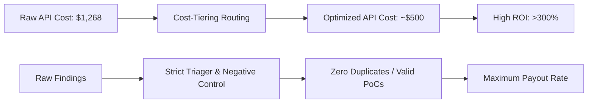

# 📊 STORM-HUNT: Financial & Operational Prospection

This document provides a forward-looking financial and operational analysis for deploying **STORM-HUNT**. It outlines the expected cost structures (primarily LLM token consumption) against potential reward structures (bug bounty payouts and CTF yields), projecting overall Return on Investment (ROI) scenarios.

---

## 1. LLM API Cost Model

STORM-HUNT's operational cost is driven by API token consumption. The table below outlines standard token pricing models per million tokens (MT) based on current provider rates.

| Model Tier | Model Example | Input Cost / MT | Output Cost / MT | Role in STORM-HUNT |
| :--- | :--- | :--- | :--- | :--- |
| **Flagship (High Reason)** | Claude 3 Opus / 4.8 | $15.00 | $75.00 | Coordinator planning & Exploit Verification |
| **Standard (Advanced)** | Claude 3.5 Sonnet | $3.00 | $15.00 | Specialist hunters, custom script writing |
| **Mechanical (Cheap)** | DeepSeek-V3 / Llama-3.1-70B | $0.14 | $0.28 | Wordlist curators, static regex scan parsers |
| **Local (Free)** | Ollama / vLLM (Local GPU) | $0.00 | $0.00 | Initial recon, port scans, local parsing |

### Token Consumption per Specialist Run (Est. 50 turns, 30k context limit)
* **Average Input Tokens:** 1.5M tokens (due to cumulative history building during tool execution).
* **Average Output Tokens:** 40k tokens.
* **Cost per Run:**
  * **Flagship (Opus):** `(1.5 * $15) + (0.04 * $75)` = **$25.50**
  * **Standard (Sonnet):** `(1.5 * $3) + (0.04 * $15)` = **$5.10**
  * **Mechanical (DeepSeek):** `(1.5 * $0.14) + (0.04 * $0.28)` = **$0.22**

---

## 2. Campaign Cost Scenarios

Operational campaigns can be divided into three execution profiles:

### Scenario A: Solo/Baseline Hunt
* **Scope:** 1 Coordinator + 2 Specialists (e.g., Recon + SSRF).
* **Composition:** Coordinator (Sonnet), Specialists (Sonnet).
* **Token Cost:** 3 runs × $5.10 = **~$15.30 per target**

### Scenario B: Specialist Ensemble Campaign
* **Scope:** 1 Coordinator + 1 Specialist running 5 passes (varying exploitation angles).
* **Composition:** Coordinator (Sonnet), 5 passes of Specialist (Sonnet), 1 Verification pass (Sonnet).
* **Token Cost:** 7 runs × $5.10 = **~$35.70 per surface**

### Scenario C: Full Swarm Audit (Endpoint Matrix)
* **Scope:** 1 Coordinator (Opus) + 15 Specialists (Cost-Tiered).
* **Composition:** 
  * Coordinator (Opus): 1 run ($25.50)
  * High-value specialists (Sonnet): 5 runs ($25.50)
  * Mechanical scanner runs (DeepSeek): 10 runs ($2.20)
  * Verification/Triager (Sonnet): 2 runs ($10.20)
* **Token Cost:** **~$63.40 per program audit**

---

## 3. Reward & Payout Structure

### Bug Bounty Programs (HackerOne / Bugcrowd / Intigriti)
Typical rewards are tiered by severity impact.

* **Critical (RCE, SQLi to DB Takeover, ATO):** $3,000 – $10,000+ (Avg: $5,000)
* **High (SSRF to metadata, Stored XSS, IDOR to PII):** $1,000 – $3,000 (Avg: $1,500)
* **Medium (Reflected XSS, CSRF, IDOR on non-critical endpoints):** $300 – $1,000 (Avg: $600)
* **Low (Info disclosure, open redirects, missing headers):** $100 – $300 (Avg: $200)

### Capture The Flag (CTF)
* **Direct Value:** Cash prizes (highly variable, typically $500 - $5,000 for top-tier team placements).
* **Indirect Value:** Talent acquisition, training speedups, and reproducible exploit modules that can be repackaged for consulting/pentest engagements.

---

## 4. Yield & ROI Matrix (20-Campaign Campaign Bundle)

Let us project the outcomes of running **20 Full Swarm Audit Campaigns** (Scenario C) at a total API cost of **$1,268** ($63.40 × 20).

### Case 1: Pessimistic (Low Success Rate - 2.5% finding rate)
> [!WARNING] **Outcome**
> * **Assumptions:** High duplicate rate, target programs are highly hardened. Only 1 Medium finding is accepted.
> * **Findings Yielded:** 1 Medium ($600)
> * **Total Rewards:** $600
> * **Net Yield:** **-$668** (ROI: -52.7%)

### Case 2: Realistic (Standard Success Rate - 15% finding rate)
> [!NOTE] **Outcome**
> * **Assumptions:** Cost-tiering is active, and RAG prevents scanning duplicates. Out of 20 targets, we land 1 High, 1 Medium, and 1 Low.
> * **Findings Yielded:** 1 High ($1,500) + 1 Medium ($600) + 1 Low ($200)
> * **Total Rewards:** $2,300
> * **Net Yield:** **+$1,032** (ROI: +81.4%)

### Case 3: Optimistic (High Success Rate - 30% finding rate)
> [!TIP] **Outcome**
> * **Assumptions:** Ensemble mode uncovers 1 Critical chain (e.g. SSRF to AWS metadata + RCE), along with multiple Highs/Mediums.
> * **Findings Yielded:** 1 Critical ($5,000) + 2 High ($3,000) + 3 Medium ($1,800)
> * **Total Rewards:** $9,800
> * **Net Yield:** **+$8,532** (ROI: +672.9%)

---

## 5. Key Leverage Factors to Maximize ROI

To skew STORM-HUNT towards the Optimistic case, the combined system must enforce these leverage points:

1. **RAG Caching (API Reduction):** By utilizing the vectorized RAG server to store previously tested endpoint structures, we avoid re-fuzzing endpoints. This can reduce total tokens by up to **40%**.
2. **Dynamic Cost-Tiering:** Mechanical agents (regex parsers, file layout checks) must run on $0.14/MT models (DeepSeek/Llama). Flagship models (Opus) must only run during the final exploit verification phase.
3. **Negative Control Gating (Zero Duplicates):** Triage agents must verify bugs before report submission. This prevents reputation loss on platforms (e.g. HackerOne response bans due to spammy AI-generated reports).
4. **Egress Containment (Scope Protection):** Ensuring tools fail immediately on off-scope domains prevents wasting expensive tokens running long recon loops on targets that do not pay rewards.
