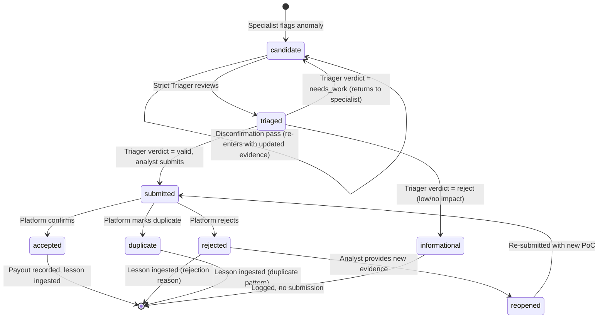

# 🔭 STORM-HUNT: Platform-Aware Observability & Learning Layer

This document specifies the durable data layer that tracks every token spent, every finding lifecycle transition, and every lesson learned — cleanly partitioned by **platform**, **program**, and **target** so that data from HackerOne never contaminates YesWeHack and vice versa.

---

## 1. Database Schema

All tables live in a single SQLite file: `~/.storm-hunt/obs.db`. SQLite is the right choice for a solo analyst machine: zero-config, single-file backup, sub-millisecond reads at our scale, and full SQL aggregation.

### 1.1 Token Ledger

Every LLM call and tool invocation writes one row. This is the cost accounting spine.

```sql
CREATE TABLE token_ledger (
    id              INTEGER PRIMARY KEY AUTOINCREMENT,
    run_id          TEXT    NOT NULL,    -- UUID grouping a single agent execution session
    timestamp       TEXT    NOT NULL DEFAULT (strftime('%Y-%m-%dT%H:%M:%fZ', 'now')),

    -- Platform partitioning (mandatory, never NULL)
    platform        TEXT    NOT NULL,    -- hackerone | bugcrowd | intigriti | yeswehack | private
    program_id      TEXT    NOT NULL,    -- program handle/slug on that platform
    target_id       TEXT    NOT NULL,    -- specific asset URL or IP being tested
    scope_id        TEXT,               -- optional finer scope partition (e.g. api.target.com vs www.target.com)

    -- Agent context
    agent_name      TEXT    NOT NULL,    -- ssrf-hunter | auth-specialist | coordinator | triager
    model_name      TEXT    NOT NULL,    -- claude-opus-4.8 | claude-sonnet-4.6 | llama-3-8b | deepseek-v3
    model_tier      TEXT    NOT NULL CHECK (model_tier IN ('local', 'mechanical', 'standard', 'flagship')),
    phase           TEXT    NOT NULL CHECK (phase IN ('recon', 'scan', 'exploit', 'triage', 'report')),
    prompt_type     TEXT    NOT NULL,    -- system | user | tool_call | tool_result | chain | verification

    -- Tool context (NULL for pure LLM chat turns)
    tool_name       TEXT,               -- nmap | curl | ffuf | nuclei | rag_search | NULL

    -- Token accounting
    input_tokens    INTEGER NOT NULL DEFAULT 0,
    output_tokens   INTEGER NOT NULL DEFAULT 0,
    estimated_cost_usd REAL NOT NULL DEFAULT 0.0,

    -- Yield tracking
    severity_class  TEXT    CHECK (severity_class IN ('none', 'low', 'medium', 'high', 'critical')),
    linked_finding_id TEXT,             -- FK to report_state.finding_id if this call produced a finding
    yield           INTEGER NOT NULL DEFAULT 0  -- 1 if this call directly contributed to a validated finding
);

-- Indexes for the aggregation queries we actually run
CREATE INDEX idx_tl_platform_program ON token_ledger(platform, program_id);
CREATE INDEX idx_tl_agent            ON token_ledger(agent_name);
CREATE INDEX idx_tl_model            ON token_ledger(model_tier, model_name);
CREATE INDEX idx_tl_phase            ON token_ledger(phase);
CREATE INDEX idx_tl_run              ON token_ledger(run_id);
CREATE INDEX idx_tl_timestamp        ON token_ledger(timestamp);
```

### 1.2 Report Lifecycle State

Every candidate finding enters this table. State transitions are append-only via `state_history`. The `state` column holds the current value.

```sql
CREATE TABLE report_state (
    finding_id          TEXT    PRIMARY KEY,  -- UUID
    report_id           TEXT,                -- platform-assigned ID after submission (NULL until submitted)

    -- Platform partitioning (mandatory)
    platform            TEXT    NOT NULL,
    program_id          TEXT    NOT NULL,
    target_id           TEXT    NOT NULL,
    scope_id            TEXT,
    asset_id            TEXT,               -- specific endpoint path or function name

    -- Classification
    bug_class           TEXT    NOT NULL,    -- ssrf | idor | xss | sqli | auth_bypass | xxe | race | deserialization | ...
    severity            TEXT    NOT NULL CHECK (severity IN ('info', 'low', 'medium', 'high', 'critical')),
    cvss_score          REAL,
    cvss_vector         TEXT,               -- e.g. AV:N/AC:L/PR:N/UI:N/S:U/C:H/I:N/A:N

    -- Confidence and quality
    confidence          REAL    CHECK (confidence BETWEEN 0.0 AND 1.0),
    evidence_quality    INTEGER CHECK (evidence_quality BETWEEN 1 AND 10),
    has_negative_control INTEGER NOT NULL DEFAULT 0,  -- 1 if a negative control was executed and passed
    has_poc             INTEGER NOT NULL DEFAULT 0,    -- 1 if a working PoC exists

    -- State machine
    state               TEXT    NOT NULL DEFAULT 'candidate'
                        CHECK (state IN (
                            'candidate',      -- specialist flagged it
                            'triaged',        -- strict-triager reviewed it
                            'submitted',      -- sent to platform
                            'accepted',       -- platform accepted / paid
                            'rejected',       -- platform rejected
                            'duplicate',      -- platform marked as duplicate
                            'informational',  -- downgraded to informational
                            'reopened'        -- re-opened after rejection
                        )),

    -- Triager feedback
    triager_verdict     TEXT    CHECK (triager_verdict IN ('valid', 'needs_work', 'reject')),
    triager_notes       TEXT,
    rejection_reason    TEXT,

    -- Submission
    submission_url      TEXT,
    payout_usd          REAL    DEFAULT 0.0,

    -- RAG integration
    rag_ingested        INTEGER NOT NULL DEFAULT 0,  -- 1 after lesson written to RAG

    -- Timestamps
    discovered_at       TEXT    NOT NULL DEFAULT (strftime('%Y-%m-%dT%H:%M:%fZ', 'now')),
    triaged_at          TEXT,
    submitted_at        TEXT,
    resolved_at         TEXT,
    last_updated        TEXT    NOT NULL DEFAULT (strftime('%Y-%m-%dT%H:%M:%fZ', 'now'))
);

CREATE INDEX idx_rs_platform_program ON report_state(platform, program_id);
CREATE INDEX idx_rs_state            ON report_state(state);
CREATE INDEX idx_rs_bug_class        ON report_state(bug_class);
CREATE INDEX idx_rs_severity         ON report_state(severity);
```

### 1.3 State Transition Log (Append-Only Audit Trail)

Every state change is recorded. This enables replaying the full lifecycle of any finding.

```sql
CREATE TABLE state_transitions (
    id              INTEGER PRIMARY KEY AUTOINCREMENT,
    finding_id      TEXT    NOT NULL REFERENCES report_state(finding_id),
    platform        TEXT    NOT NULL,
    program_id      TEXT    NOT NULL,
    from_state      TEXT    NOT NULL,
    to_state        TEXT    NOT NULL,
    trigger         TEXT    NOT NULL,    -- triager | analyst | platform_response | manual | disconfirm
    notes           TEXT,
    timestamp       TEXT    NOT NULL DEFAULT (strftime('%Y-%m-%dT%H:%M:%fZ', 'now'))
);

CREATE INDEX idx_st_finding ON state_transitions(finding_id);
CREATE INDEX idx_st_platform ON state_transitions(platform, program_id);
```

### 1.4 RAG Lessons Table

Structured lesson records written after state transitions. Platform-scoped by default; generalizable via the `generalized` flag.

```sql
CREATE TABLE rag_lessons (
    lesson_id           TEXT    PRIMARY KEY,  -- UUID
    timestamp           TEXT    NOT NULL DEFAULT (strftime('%Y-%m-%dT%H:%M:%fZ', 'now')),

    -- Platform partitioning
    platform            TEXT    NOT NULL,
    program_id          TEXT    NOT NULL,
    target_id           TEXT    NOT NULL,

    -- Context
    surface             TEXT    NOT NULL,    -- e.g. /api/v1/users/{id} or login flow
    bug_class           TEXT    NOT NULL,
    attempted_pattern   TEXT    NOT NULL,    -- what the specialist tried
    outcome             TEXT    NOT NULL CHECK (outcome IN (
                            'accepted', 'rejected', 'duplicate',
                            'false_positive', 'blocked', 'mitigated'
                        )),
    reasoning           TEXT    NOT NULL,    -- why it succeeded or failed
    recommendation      TEXT    NOT NULL,    -- what to do (or avoid) next time

    -- Links
    linked_finding_id   TEXT    REFERENCES report_state(finding_id),
    linked_report_id    TEXT,

    -- Scope control
    generalized         INTEGER NOT NULL DEFAULT 0,  -- 0 = platform-scoped, 1 = cross-platform reusable
    rag_chunk_id        TEXT                         -- chunk ID in the RAG vector store after ingestion
);

CREATE INDEX idx_rl_platform_program ON rag_lessons(platform, program_id);
CREATE INDEX idx_rl_outcome          ON rag_lessons(outcome);
CREATE INDEX idx_rl_bug_class        ON rag_lessons(bug_class);
```

---

## 2. Report State Machine



### Transition Rules (Hard-Coded Policy)

| From | To | Trigger | Required Condition |
|---|---|---|---|
| `candidate` | `triaged` | `triager` | Triager executed 100% replay and assigned verdict |
| `candidate` | `candidate` | `disconfirm` | Disconfirmation gate fired and returned updated evidence |
| `triaged` | `submitted` | `analyst` | `triager_verdict = 'valid'` AND `has_negative_control = 1` AND `has_poc = 1` |
| `triaged` | `candidate` | `triager` | `triager_verdict = 'needs_work'` (missing evidence, back to specialist) |
| `triaged` | `informational` | `triager` | `triager_verdict = 'reject'` AND severity ≤ low |
| `submitted` | `accepted` | `platform_response` | Platform response received, payout assigned |
| `submitted` | `rejected` | `platform_response` | Platform rejected, `rejection_reason` populated |
| `submitted` | `duplicate` | `platform_response` | Platform marked as duplicate |
| `rejected` | `reopened` | `manual` | Analyst provides new evidence or different PoC approach |
| `reopened` | `submitted` | `analyst` | Re-submission with updated report |

### Blocked Transitions (Enforced in Code)

* `candidate` → `submitted`: **BLOCKED.** You cannot submit without triaging first. No exceptions.
* `triaged` → `submitted` without `has_negative_control = 1`: **BLOCKED.** Every submission must include a verified negative control.
* `accepted` → any non-terminal: **BLOCKED.** Accepted findings are immutable.
* Any state → `accepted` without `payout_usd > 0` or explicit `$0` confirmation: **BLOCKED.** Prevents silent acceptance without payout tracking.

---

## 3. RAG Ingestion Rules

### 3.1 What Triggers a RAG Write

| Event | Trigger Condition | Lesson Outcome |
|---|---|---|
| Finding accepted by platform | `state` transitions to `accepted` | `accepted` — records what worked |
| Finding rejected by platform | `state` transitions to `rejected` | `rejected` — records why it failed |
| Finding marked duplicate | `state` transitions to `duplicate` | `duplicate` — records the pattern to avoid re-testing |
| Triager marks false positive | `triager_verdict = 'reject'` AND negative control disproves | `false_positive` — marks the surface as tested-and-clean |
| Disconfirmation gate flips a "blocked" verdict | Disconfirm pass finds the bug behind the wall | `blocked` lesson updated to show the unblocking technique |
| Triager confirms mitigation | Finding exists but defense-in-depth blocks exploitation | `mitigated` — records the mitigation for future reference |

### 3.2 Lesson Record Format

Every RAG lesson is stored as structured JSON and simultaneously vectorized into the RAG store:

```json
{
  "lesson_id": "uuid",
  "platform": "yeswehack",
  "program_id": "swiss-post-evoting",
  "target_id": "pit.evoting.ch",
  "surface": "/api/v1/processor/voting/confirmvote",
  "bug_class": "idor",
  "attempted_pattern": "Swapped verificationCardId UUID in path while keeping same session",
  "outcome": "rejected",
  "reasoning": "Server validates verificationCardId against the credentialId bound to the session. Cross-references checked server-side in IdentifierValidationService.",
  "recommendation": "Do not re-test IDOR via UUID path swap on this endpoint unless the session binding logic changes in a future release.",
  "linked_finding_id": "abc-123",
  "linked_report_id": null,
  "generalized": 0
}
```

### 3.3 Platform-Scoped Namespacing in RAG

The existing [VectorStore](file:///home/souhail/Desktop/Desktop/bbp/harness/rag/pihunt_rag/store.py) `chunks` table already supports `source`, `kind`, and `program` filters. We extend this with a `platform` column:

```sql
-- Migration to add platform awareness to the existing RAG chunks table
ALTER TABLE chunks ADD COLUMN platform TEXT DEFAULT 'unknown';
CREATE INDEX IF NOT EXISTS idx_chunks_platform ON chunks(platform);
CREATE INDEX IF NOT EXISTS idx_chunks_platform_program ON chunks(platform, program);
```

**Search isolation rule:** When a specialist queries RAG before testing a target, the query is scoped:

```python
# Default: platform-scoped search (never leak cross-platform lessons)
results = store.search(
    query="ssrf cloud metadata bypass",
    k=5,
    source="lessons",
    platform="hackerone",        # hard filter
    program="target-corp"        # optional narrowing
)

# Cross-platform search (only when explicitly requested by analyst)
results = store.search(
    query="ssrf cloud metadata bypass",
    k=5,
    source="lessons",
    platform=None,               # NULL = search all platforms
    where_extra="generalized = 1" # only generalized lessons cross boundaries
)
```

### 3.4 Anti-Duplication via RAG Pre-Check

Before a specialist begins scanning a surface, the orchestrator runs a mandatory RAG pre-check:

```
1. Query: rag_search(surface + bug_class, platform=X, program=Y)
2. If results contain a lesson with outcome="duplicate" or outcome="rejected"
   AND the surface/pattern match is above similarity threshold (cosine > 0.85):
   → Log a SKIP event to token_ledger (phase="recon", yield=0)
   → Do NOT dispatch the specialist
   → Return the skip reason to the coordinator
3. If results contain outcome="accepted" for same surface:
   → Flag as "previously rewarded surface — check for variant or regression only"
```

---

## 4. Aggregate Metric Queries

These are the concrete SQL queries the analyst runs to monitor system health.

### 4.1 Cost per Verified Finding (by Platform)
```sql
SELECT
    platform,
    program_id,
    ROUND(SUM(estimated_cost_usd), 2) AS total_cost,
    COUNT(DISTINCT CASE WHEN yield = 1 THEN linked_finding_id END) AS verified_findings,
    ROUND(SUM(estimated_cost_usd) /
        NULLIF(COUNT(DISTINCT CASE WHEN yield = 1 THEN linked_finding_id END), 0), 2
    ) AS cost_per_finding
FROM token_ledger
GROUP BY platform, program_id
ORDER BY cost_per_finding DESC;
```

### 4.2 Triager Rejection Rate (by Platform)
```sql
SELECT
    platform,
    program_id,
    COUNT(*) AS total_triaged,
    SUM(CASE WHEN triager_verdict = 'reject' THEN 1 ELSE 0 END) AS rejected,
    ROUND(100.0 * SUM(CASE WHEN triager_verdict = 'reject' THEN 1 ELSE 0 END) / COUNT(*), 1) AS reject_pct
FROM report_state
WHERE state != 'candidate'  -- only count things that reached triage
GROUP BY platform, program_id;
```

### 4.3 Payout per Token Dollar (by Platform)
```sql
SELECT
    rs.platform,
    rs.program_id,
    ROUND(SUM(rs.payout_usd), 2) AS total_payout,
    ROUND(SUM(tl.estimated_cost_usd), 2) AS total_api_cost,
    ROUND(SUM(rs.payout_usd) / NULLIF(SUM(tl.estimated_cost_usd), 0), 2) AS roi_ratio
FROM report_state rs
JOIN token_ledger tl ON tl.platform = rs.platform AND tl.program_id = rs.program_id
WHERE rs.state = 'accepted'
GROUP BY rs.platform, rs.program_id;
```

### 4.4 Expensive Low-Yield Pattern Detection
```sql
SELECT
    agent_name,
    model_tier,
    phase,
    platform,
    program_id,
    COUNT(*) AS total_calls,
    SUM(input_tokens + output_tokens) AS total_tokens,
    ROUND(SUM(estimated_cost_usd), 2) AS total_cost,
    SUM(yield) AS yielded_findings,
    ROUND(100.0 * SUM(yield) / COUNT(*), 1) AS yield_pct
FROM token_ledger
GROUP BY agent_name, model_tier, phase, platform, program_id
HAVING yield_pct < 5.0 AND total_cost > 2.0
ORDER BY total_cost DESC;
```

This query surfaces the actionable simplification recommendation: "Agent X on model tier Y in phase Z spent $N with <5% yield — consider downgrading the model tier or reducing the turn cap."

### 4.5 Duplicate Rate (by Platform)
```sql
SELECT
    platform,
    program_id,
    COUNT(*) AS total_submitted,
    SUM(CASE WHEN state = 'duplicate' THEN 1 ELSE 0 END) AS duplicates,
    ROUND(100.0 * SUM(CASE WHEN state = 'duplicate' THEN 1 ELSE 0 END) / COUNT(*), 1) AS dup_pct
FROM report_state
WHERE state IN ('accepted', 'rejected', 'duplicate')
GROUP BY platform, program_id;
```

---

## 5. Implementation Priorities

### Priority 1: Token Ledger (Day 1)
Without cost tracking, every other optimization is flying blind. The ledger is the first table created and the first write hook wired into the LLM backbone.

### Priority 2: Report State Table + State Machine (Day 2–3)
The finding lifecycle is the core data model that everything else references. Transition enforcement prevents premature submissions.

### Priority 3: State Transition Log (Day 3)
Append-only audit trail. Trivial to implement once report_state exists. Enables debugging "how did this finding end up rejected?"

### Priority 4: RAG Lessons Table + Ingestion Hooks (Day 4–5)
Wire the state machine so that transitions to `accepted`, `rejected`, and `duplicate` automatically create lesson records and vectorize them into the RAG store.

### Priority 5: Aggregate Queries + Dashboard (Day 6–7)
Write the five SQL queries above as a CLI command (`storm-hunt metrics`) that prints a formatted summary.

### Priority 6: RAG Pre-Check Gate (Day 8)
Before dispatching a specialist, query the lessons table. Skip known-dead paths. This is where the system starts saving real tokens.

---

## 6. Minimal Viable Phase 1

Phase 1 delivers the narrowest slice that provides actual operational value:

### What ships in Phase 1
1. **SQLite database** with `token_ledger`, `report_state`, and `state_transitions` tables.
2. **Token logging middleware** that wraps every LLM backbone call and writes a row to `token_ledger` before returning the response to the agent.
3. **Report state CRUD** with enforced transition rules (the blocked transitions above are hard-coded `if` guards, not suggestions).
4. **A CLI command** (`storm-hunt metrics --platform hackerone`) that runs the aggregate queries and prints:
   - Total spend by platform/program
   - Findings by state
   - Rejection rate
   - Cost per verified finding

### What does NOT ship in Phase 1
- RAG vectorization of lessons (deferred to Phase 2).
- Automatic RAG pre-check gating (deferred to Phase 2).
- Cross-platform lesson generalization (deferred to Phase 3).
- Web dashboard (out of scope entirely — CLI is sufficient for solo operation).

### Phase 1 Simplifications (Honest About Complexity)

> [!IMPORTANT]
> **What was simplified and why:**
> - The `generalized` flag on RAG lessons exists in the schema but is not evaluated in Phase 1. Cross-platform lesson sharing is a Phase 3 concern. For now, all lessons are platform-scoped by default.
> - The `scope_id` and `asset_id` fields are optional in Phase 1. They become mandatory in Phase 2 when the system starts doing per-asset cost attribution.
> - The disconfirmation gate (from pi-hunt's [disconfirm.ts](file:///home/souhail/Desktop/Desktop/bbp/harness/pi-agent/extensions/subagent/disconfirm.ts)) is wired as a state transition (`candidate → candidate` with updated evidence) but the automatic firing logic is Phase 2.
> - Token cost estimation uses a static lookup table (model → price/MT) rather than parsing actual API billing responses. This is accurate enough for planning and avoids coupling to provider billing APIs.

---

## 7. Platform-Aware Behavior Matrix

| Workflow Step | Platform Awareness |
|---|---|
| **Target selection** | Load `profile.json` which declares `platform` field. All downstream records inherit it. |
| **Scope validation** | Scope regex patterns are keyed by `(platform, program_id)`. A HackerOne wildcard scope does not authorize testing an Intigriti target. |
| **Rate limits** | `operational_rules.max_requests_per_second` is per-profile. YesWeHack manual-only rules get lower limits than HackerOne programs that allow automation. |
| **Report formatting** | Platform-specific templates: HackerOne Markdown, Bugcrowd structured fields, YesWeHack CVSS-mandatory format. |
| **Triage rules** | Platform-specific severity rules (e.g., YesWeHack C.5.1 requires working PoC for context-dependent classes; HackerOne may accept theoretical impact for some programs). |
| **Token accounting** | Every `token_ledger` row carries `platform` + `program_id`. Cost aggregation is always scoped. |
| **RAG retrieval** | Lessons are filtered by `platform` by default. Cross-platform retrieval requires `generalized = 1`. |
| **Duplicate detection** | Duplicate checks query `report_state WHERE platform = ? AND program_id = ?`. A finding is only a duplicate within its own platform/program pair. |
