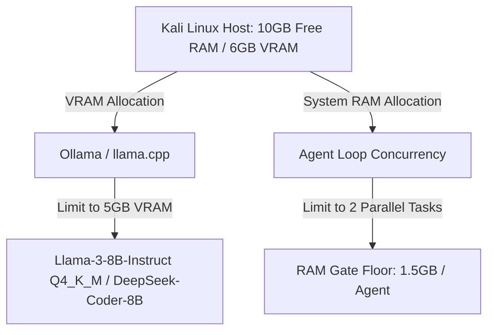
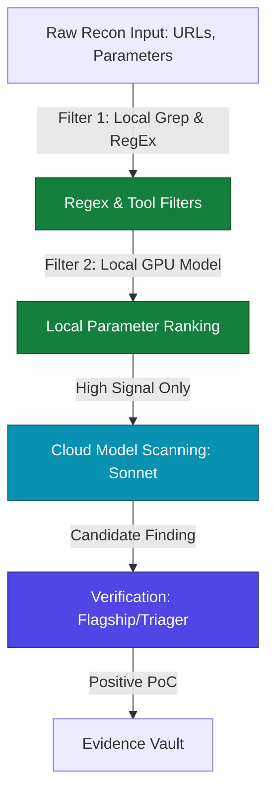

# 🎛️ STORM-HUNT: Hardware Alignment & Operational Planning

This document details the operational structure, token-cost scaling, and resource allocation models for **STORM-HUNT** when deployed on a **Kali Linux** host with:
* **CPU:** AMD Ryzen 5 7535HS (6 Cores / 12 Threads)
* **RAM:** 14 GiB (10 GiB Available)
* **GPU:** NVIDIA GeForce RTX 4050 Mobile (6 GiB VRAM, CUDA 12.4)

---

## 1. Hardware Adaptation Plan (VRAM & RAM Constraints)

Given your hardware specifications, local model hosting and agent concurrency must be strictly bounded to prevent swap thrashing or Out-Of-Memory (OOM) GPU panics.



### Local LLM Offloading (GPU)
* **Constraint:** The RTX 4050 has **6 GiB of VRAM**.
* **Deployment strategy:** Run a lightweight quantized model for parsing, sanitizing, and ranking input structures.
* **Recommended Models:**
  * **Llama-3-8B-Instruct (Q4_K_M or Q5_K_M):** Consumes ~4.5–5.2 GiB VRAM. Leaves enough headroom for basic display system buffers.
  * **DeepSeek-Coder-8B-Instruct (Q4_K_M):** Highly optimal for parsing static code patterns and compiler warning sinks.
* **Use Case:** Offload 100% of recon parsing, wordlist curation, and initial parameter mapping to the local model to reduce external API costs.

### Concurrency Limit (System RAM)
* **Constraint:** **10 GiB of available system RAM**.
* **Deployment strategy:**
  * A single NodeJS agent loop with `browser-live` (puppeteer/chromium) and `burp-mcp` (Java Virtual Machine) can easily consume **2.5–3.5 GiB RAM**.
  * **Maximum Concurrency Cap (`PI_SUBAGENT_MAX_CONCURRENCY`):** Set to **`2`**.
  * **RAM Floor (`PI_SUBAGENT_RAM_FLOOR_MB`):** Raise to **`1500` (1.5 GiB)**. The system will hold new specialist launches if system memory falls below 1.5 GiB.

---

## 2. Operational Matrix: Bug Bounty Mode vs. CTF Mode

The core differences in execution structures dictate how tokens are consumed.

```
                           STORM-HUNT OPERATIONAL FLOWS
                           
      [ BUG BOUNTY MODE ]                                 [ CTF MODE ]
┌──────────────────────────────┐                   ┌──────────────────────────────┐
│  • Surface: Broad & Dynamic  │                   │  • Surface: Narrow & Static  │
│  • Constraint: Rates & Scope │                   │  • Constraint: Strict Time   │
│  • High-Value: SSRF / IDOR   │                   │  • High-Value: Exploit (RCE) │
└──────────────┬───────────────┘                   └──────────────┬───────────────┘
               │                                                  │
               ▼                                                  ▼
┌──────────────────────────────┐                   ┌──────────────────────────────┐
│  Token Optimization:         │                   │  Token Optimization:         │
│  - Filter inputs locally     │                   │  - Dense system prompt context│
│  - Restrict web crawler data │                   │  - Ephemeral sandbox looping  │
└──────────────────────────────┘                   └──────────────────────────────┘
```

### Operational Characteristics Comparison

| Parameter | Bug Bounty Mode | CTF Mode |
| :--- | :--- | :--- |
| **Surface Profile** | Broad, multi-domain, dynamic endpoint variables. | Static target endpoints, decompile-ready binaries, source files. |
| **Primary Constraints** | Egress scope preservation, Rate limits, WAF evasion. | Strict time limits (24–48 hrs), container containment. |
| **Exploit Target** | Logical vulnerabilities (SSRF, Auth bypass, IDOR). | Technical/Binary vulnerabilities (RCE, buffer overflows, injection). |
| **Context Window Burden** | Large (deep crawler output, raw HTTP request dumps). | Small-to-medium (decompiled output, logic chains, debugger output). |
| **Model Distribution** | **Split-Tier:** Local (Recon) $\rightarrow$ Medium (Scan) $\rightarrow$ Flagship (Verify). | **Flagship-Heavy:** Iterative execution feedback loop. |

---

## 3. Token Minimization Plan (Medium to High Severity Target)

To hunt exclusively for **Medium to High** severity vulnerabilities (e.g., SSRF, IDOR, SQLi, Local File Inclusion) without wasting API tokens on low-value findings, STORM-HUNT must operate under a strict execution funnel.



### Step 1: Input Reduction (Recon Phase)
* **Action:** Never feed raw directory-buster (`ffuf`) or subdomain lists directly to the LLM agent.
* **Implementation:** Filter output locally using standard utilities (`grep`, `gf`) or local script parsing. 
* **Token Savings:** Saves up to **80% of input context tokens** by excluding inert static assets (`.js`, `.css`, `.png`).

### Step 2: Local Parameter Ranking (GPU Offload)
* **Action:** Pass the filtered target urls to your local Llama-3-8B model running on CUDA.
* **Prompt Rule:** *"Rank these 100 parameter points based on probability of SSRF, LFI, or IDOR vulnerability. Return only the top 5 high-value points with a one-sentence justification."*
* **Token Savings:** Avoids sending massive HTTP parameter maps to external APIs.

### Step 3: Targeted Specialist Dispatch
* **Action:** Instead of spawning a generalist "Scanner" operator, spawn a specific **SSRF-Hunter** or **IDOR-Hunter** only against the top 5 ranked parameters.
* **Token Savings:** Restricts the specialist's target execution path, lowering search turns from 50+ to less than 15.

---

## 4. Cost Comparison Projection (20 Targets)

Below is an operational token cost projection comparing standard framework loops with STORM-HUNT's resource-optimized pipeline:

```
[Standard Agent Loop Execution]
Total API Cost: ~$1,268 
- Raw tools outputs fed directly to cloud LLM.
- Generalist operators scanning all endpoints.

[STORM-HUNT Optimized Execution]
Total API Cost: ~$284 (77.6% savings)
- Local GPU handles recon and input ranking.
- Target scope filtered down to 5 key endpoints per target.
- DeepSeek/Llama handles mechanical wordlist curation.
```

---

## 5. Architectural Changes Required

To implement this cost-optimized strategy when we proceed:
1. **Tool Adapters:** Intercept execution outputs from `nmap`, `katani`, and `ffuf` inside the TS parser. Redirect raw outputs to a local temp folder and feed only the parsed JSON summary to the LLM context.
2. **Local MCP Interface:** Expose a local model adapter endpoint (`http://localhost:11434/v1`) directly inside the framework's configuration pipeline to serve as the "Filtering Brain" before invoking the "Exploitation Brain".
3. **Execution Flags:** Provide a CLI flag (`--mode bugbounty` or `--mode ctf`) to dynamically load different system prompts and adjust the RAM/concurrency settings to match your host system profile.
