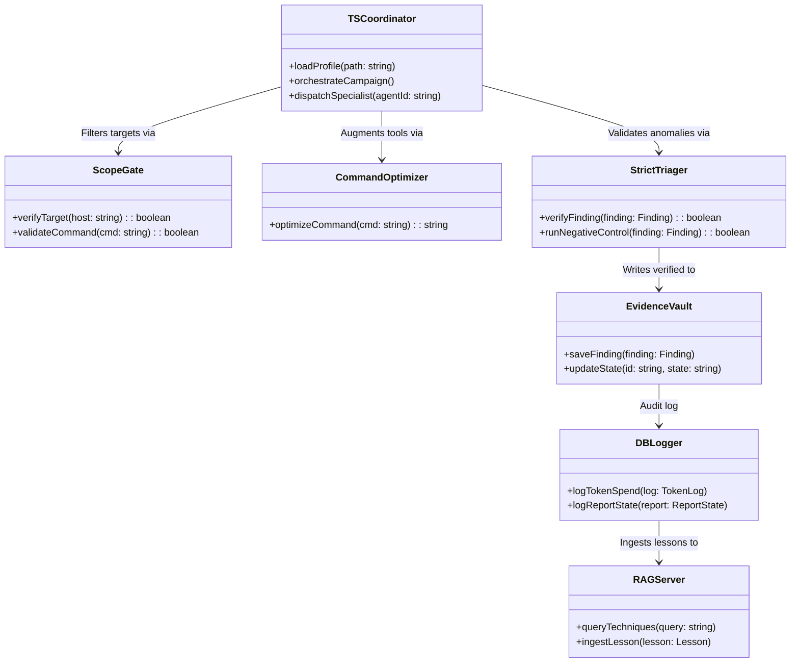

# 🛠️ STORM-HUNT: Detailed Synergy Plan & Component Architecture

This document maps out the specific file components required from **T3MP3ST** and **pi-hunt (harness)**, defines the integrated system architecture, and outlines a step-by-step synergy plan to construct the unified Bug-Bounty-Only framework.

---

## 1. Component Extraction Map

To build STORM-HUNT, we extract specific functional modules from each codebase:

### Extracted from T3MP3ST (`/home/souhail/Desktop/Desktop/T3MP3ST`)
* **TypeScript Core Orchestrator (`src/index.ts`, `src/config/`, `src/llm/`):** Houses the multi-agent backbone, configuration settings loader, event emitters, and OpenRouter/Ollama connections.
* **Evidence Vault with Verification Gate (`src/evidence/index.ts`, `src/evidence/gate.ts`):** Enforces that no finding is flagged as `verified` unless it has concrete tool-output provenance.
* **Network & Egress containment (`src/opsec/`):** Programmatic blockades to prevent tools from calling off-scope targets.
* **Tool Adapter Interface (`src/arsenal/adapter-tools.ts`, `src/arsenal/catalog.ts`):** Standardizes tool configurations, exit codes, and stdout/stderr parsers for basic utilities (`nmap`, `curl`, DNS lookups).

### Extracted from pi-hunt (`/home/souhail/Desktop/Desktop/bbp/harness`)
* **Specialist Agent Instructions (`pi-agent/agents/*.md`):** Porting `ssrf-hunter.md`, `idor-logic-hunter.md`, `sqli-hunter.md`, `oauth-hunter.md`, and `strict-triager.md`.
* **SecLists Command Optimizer (`pi-agent/extensions/cmd-optimizer/`):** Augments command strings inline to inject optimal wordlists (e.g., `raft-large-directories.txt`) into tools like `ffuf` or `gobuster`.
* **Subagent Concurrency Manager (`pi-agent/extensions/subagent/index.ts`, `ensemble.ts`):** Limits concurrently executing subagents and checks the host's `MemAvailable` (RAM Gate).
* **Technique RAG Server (`rag/`):** The vector storage database indexing exploit writeups, techniques, and past campaign outcomes.

---

## 2. Integrated Component Architecture

The unified STORM-HUNT runtime is structured as follows:

```
📁 STORM-HUNT (Unified Project Root)
├── package.json              # Merged dependencies (T3MP3ST TS + pi-hunt packages)
├── tsconfig.json             # TypeScript project definitions
├── src/
│   ├── index.ts              # System entry point
│   ├── config/               # Program Profile Loader (profile.json)
│   ├── db/                   # Observability Layer (SQLite client & logging schemas)
│   ├── llm/                  # Split-Tier model router (Ollama + OpenRouter)
│   ├── orchestrator/         # Swarm Concurrency Manager & RAM Gate
│   ├── operators/            # Swarm operators (Coordinator, Triager)
│   │   └── specialists/      # Specialized Hunters (SSRF, IDOR, OAuth, Upload, JS)
│   ├── evidence/             # Evidence Vault & negative control logic
│   └── arsenal/              # Tool executor
│       ├── catalog.ts        # Permitted security tool wrappers
│       ├── gate.ts           # Egress scope verification filter
│       └── optimizer.ts      # Command-Optimizer wordlist injector
```

### Component Details



---

## 3. Synergy Plan: Phase-by-Phase Integration

We will execute the merger in four distinct phases to ensure type safety, clean dependencies, and verifiable operation.

```
                      STORM-HUNT SYNERGY ROADMAP
                      
  [ PHASE 1: FOUNDATION & PROGRAM PARSER ]
  ┌─────────────────────────────────────────────────────────────┐
  │  • Establish workspace structure & merge configurations     │
  │  • Implement SQLite Observability layer                     │
  │  • Create dynamic Program Profile (profile.json) parser     │
  └─────────────────────────────────────────────────────────────┘
  
  [ PHASE 2: INTEGRATE RUNTIME FILTERS ]
  ┌─────────────────────────────────────────────────────────────┐
  │  • Merge T3MP3ST Egress Gates with pi-hunt Command Optimizer │
  │  • Bind maximum requests-per-second constraints             │
  └─────────────────────────────────────────────────────────────┘
  
  [ PHASE 3: SPECIALISTS PORTING & CONCURRENCY ]
  ┌─────────────────────────────────────────────────────────────┐
  │  • Convert pi-hunt .md agents into TypeScript Operatives    │
  │  • Port Subagent Concurrency engine and hardware RAM Gate  │
  └─────────────────────────────────────────────────────────────┘
  
  [ PHASE 4: TRIAGING & RAG PIPELINE ]
  ┌─────────────────────────────────────────────────────────────┐
  │  • Implement Strict Triager with automated negative controls │
  │  • Connect DB State changes to RAG Graph writes             │
  └─────────────────────────────────────────────────────────────┘
```

### Phase 1: Core Foundation & Observability
1. **Initialize Project Root:** Set up a clean Node/TS workspace. Merge package dependencies, retaining only required libraries (e.g., `eventemitter3`, `sqlite3`, `typebox`).
2. **Implement SQLite Logger (`src/db/logger.ts`):** 
   * Implement the `token_logs` and `report_state` database tables.
   * Expose functions: `logTokenSpend()` and `logReportState()`.
3. **Build the Program Profile Parser (`src/config/profile.ts`):**
   * Write TypeScript types (using `TypeBox` or standard interfaces) to load and validate target `profile.json` parameters.

### Phase 2: Tool Adapters, Scope Containment, and Command Optimization
1. **Port the Command Optimizer (`src/arsenal/optimizer.ts`):**
   * Port pi-hunt's pure JS [optimize.ts](file:///home/souhail/Desktop/Desktop/bbp/harness/pi-agent/extensions/cmd-optimizer/optimize.ts) file.
   * Augment raw CLI parameters dynamically to map to local `/usr/share/seclists/` directory wordlists on Kali.
2. **Integrate Scope Gate (`src/arsenal/gate.ts`):**
   * Combine T3MP3ST's egress scope filter with the `profile.json` wildcard domain checking arrays.
   * Wrap command executions so that any tool request is intercepted, checked for scope safety, optimized, and rate-limited.

### Phase 3: Specialist Porting & Concurrency Engine
1. **Convert Specialists to Operators (`src/operators/specialists/`):**
   * Map the markdown specialist prompts (e.g., [ssrf-hunter.md](file:///home/souhail/Desktop/Desktop/bbp/harness/pi-agent/agents/ssrf-hunter.md)) into structured TS operator profiles extending T3MP3ST's `OperatorAgent` class.
2. **Implement Swarm Manager (`src/orchestrator/concurrency.ts`):**
   * Port the memory checker and task executor from pi-hunt's subagent extension. 
   * Enforce concurrency limits (`MAX_CONCURRENCY = 2`) and target system RAM floor checks before spawning processes.

### Phase 4: Strict Verification & RAG Learning Loop
1. **Build Triager Logic (`src/evidence/triager.ts`):**
   * Port `strict-triager.md` logic. Create verification routines that require the execution of a negative control.
2. **Connect the RAG Learning Loop:**
   * Write hooks in `EvidenceVault` so that when a finding state updates to `accepted` or `rejected`, a lesson payload is formatted and sent to the local Vector RAG MCP server.
   * Add query hooks in the specialist base initialization routines to consult RAG historical data before performing new scans.
